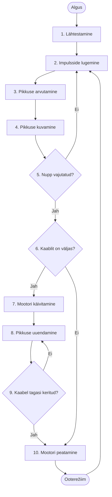

# Automaatne-kaablirull

Mehatroonikasüsteemide õppeaine projekt: automaatse tagasikeritava pikendusjuhtme juhtprogramm Arduino C++ keeles.

## Programm
[Kaablirull.ino](Kaablirull/Kaablirull.ino)

## Algoritmi plokkskeem

## Komponendid ja eeldused

Arduino Uno, enkooder D2/D3, nupp D4, lõppasendi lüliti D7, mootoridraiver D8, I2C LCD SDA/SCL. Vajalik LiquidCrystal_I2C teek.

Näidisväärtus 5 mm impulsi kohta tuleb kalibreerida. Enkoodri suund tuleb kontrollida. Käivitamisel eeldatakse nullasendit. Lisatud on 30 sekundi ajalimiit ja lõppasendi lüliti. Mootorit ei ühendata otse Arduino väljundisse. Koodi ei ole füüsilisel seadmel testitud.
